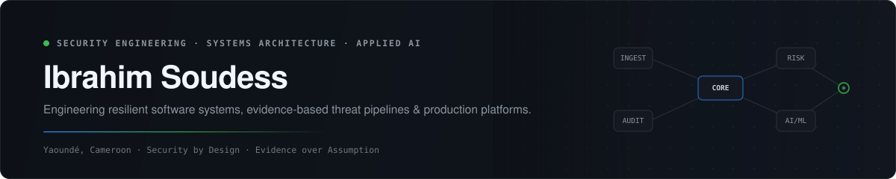

<picture>
  <source media="(prefers-color-scheme: dark)" srcset="./assets/header-dark.svg" />
  <source media="(prefers-color-scheme: light)" srcset="./assets/header-light.svg" />
  
</picture>

  <a href="https://portfolio-ibrahim-kohl.vercel.app"><strong>Portfolio</strong></a>
  &nbsp;&middot;&nbsp;
  <a href="https://www.linkedin.com/in/moumbagna-nchare-ibrahim-soudess-85072a390"><strong>LinkedIn</strong></a>
  &nbsp;&middot;&nbsp;
  <a href="https://www.credly.com/users/moumbagna-nchare-ibrahim-soudess/badges"><strong>Verified Credentials (Credly)</strong></a>
  &nbsp;&middot;&nbsp;
  <a href="https://www.facebook.com/ibrahim.soudess.ibrahim.soudess"><strong>Facebook</strong></a>
  &nbsp;&middot;&nbsp;
  <a href="mailto:ibrahimsoudess7@gmail.com"><strong>Email</strong></a>

---

### Focus & Engineering Philosophy

I design and build **security-first software systems**, **threat-analysis pipelines**, and **production web platforms** engineered for operational reliability and clear maintainability.

- **Evidence over Assumption** — Decisions, risk scores, and alerts should be explainable, traceable, and backed by verifiable signals rather than opaque heuristics.
- **Security by Design** — Threat modeling, strict input/query boundaries (OWASP, CSRF/XSS/SQLi mitigation), least privilege, and immutable audit trails belong in the initial architecture—not as post-release patches.
- **Pragmatic Architecture** — Modular boundaries, clean contracts, and lean dependencies built to solve real operational problems from MVP to production.

---

### Selected Systems

| System | Engineering Scope & Security Posture | Primary Stack | Links |
| :--- | :--- | :--- | :--- |
| **[SecureLink](https://github.com/IBRAHIM-SOUDESS/securelink)** | Multi-engine anti-phishing & fraud analysis pipeline (`Message`, `URL`, `Relation`, `Risk`, `Explanation`). Correlates homoglyph/lookalike domains and behavioral risk signals with real-time threat feeds (**VirusTotal**, **URLhaus**). | `Next.js` · `TypeScript` · `FastAPI` · `PostgreSQL` | [Live App](https://securelink-puce.vercel.app) · [Repo](https://github.com/IBRAHIM-SOUDESS/securelink) |
| **[ITSM Helpdesk](https://github.com/IBRAHIM-SOUDESS/gestion-demande-interne)** | Enterprise incident & service-request platform for ETS KAMAL. Real-time `Impact × Urgency` priority matrix, analytics dashboard, PDF/CSV intervention exports, CSRF tokens, prepared queries, and audit logging. | `PHP 8` · `MySQL` · `Tailwind CSS` · `Chart.js` | [Repo](https://github.com/IBRAHIM-SOUDESS/gestion-demande-interne) |
| **[Tekrin](https://github.com/IBRAHIM-SOUDESS/tekrin)** | Modular proximity marketplace & social network connecting skilled technicians with clients. Guided onboarding workflow, reputation engine, role-based access control, and campaign manager. | `PHP 8` · `MySQL` · `JavaScript` · `CSS3` | [Repo](https://github.com/IBRAHIM-SOUDESS/tekrin) |
| **[Livra-Cam](https://github.com/IBRAHIM-SOUDESS/livra-cam)** | Parcel logistics tracking and dispatch automation system. Dynamic QR Code generation, standardized print-media shipping labels, automated daily reporting, and strict non-emulated PDO data access. | `PHP (PDO)` · `MySQL` · `JavaScript` · `QR Engine` | [Repo](https://github.com/IBRAHIM-SOUDESS/livra-cam) |

---

### Core Capabilities

| Domain | Practices & Technologies |
| :--- | :--- |
| **Application & Network Security** | OWASP Top 10 Mitigation (SQLi, XSS, CSRF), Threat Intelligence Integration (VirusTotal, URLhaus), Audit Logging, Applied Cryptography, TCP/IP & Networking Fundamentals |
| **Backend & Data Systems** | Python (`FastAPI`), PHP 8 (`PDO` / `MySQLi`), PostgreSQL (`Supabase`), MySQL / MariaDB, REST API Design, MVC & Multi-Engine Pipelines |
| **Applied AI & Automation** | Generative AI Integration, LLM Workflows, Prompt Engineering, Explainable Risk Scoring, AI Governance & Ethics |
| **Frontend & Delivery** | TypeScript, React 19, Next.js, Vite, Tailwind CSS v4, Data Visualization (`Chart.js`), Git/SSH Cryptographic Commit Signing |

---

### Verified Credentials

All 6 official certifications are independently verifiable on **[Credly](https://www.credly.com/users/moumbagna-nchare-ibrahim-soudess/badges)** :

- **IBM SkillsBuild** — *Cybersecurity Fundamentals* · *Getting Started with Generative AI*
- **Cisco & OpenEDG** — *Python Essentials 1*
- **Cisco Networking Academy** — *Networking Basics* · *Introduction to Modern AI* · *Introduction to Cybersecurity*

---

### Collaboration

Open to **engineering roles, security-focused collaborations, internships/apprenticeships, and high-impact product builds**.
Reach out via **[LinkedIn](https://www.linkedin.com/in/moumbagna-nchare-ibrahim-soudess-85072a390)** or **[ibrahimsoudess7@gmail.com](mailto:ibrahimsoudess7@gmail.com)**.
